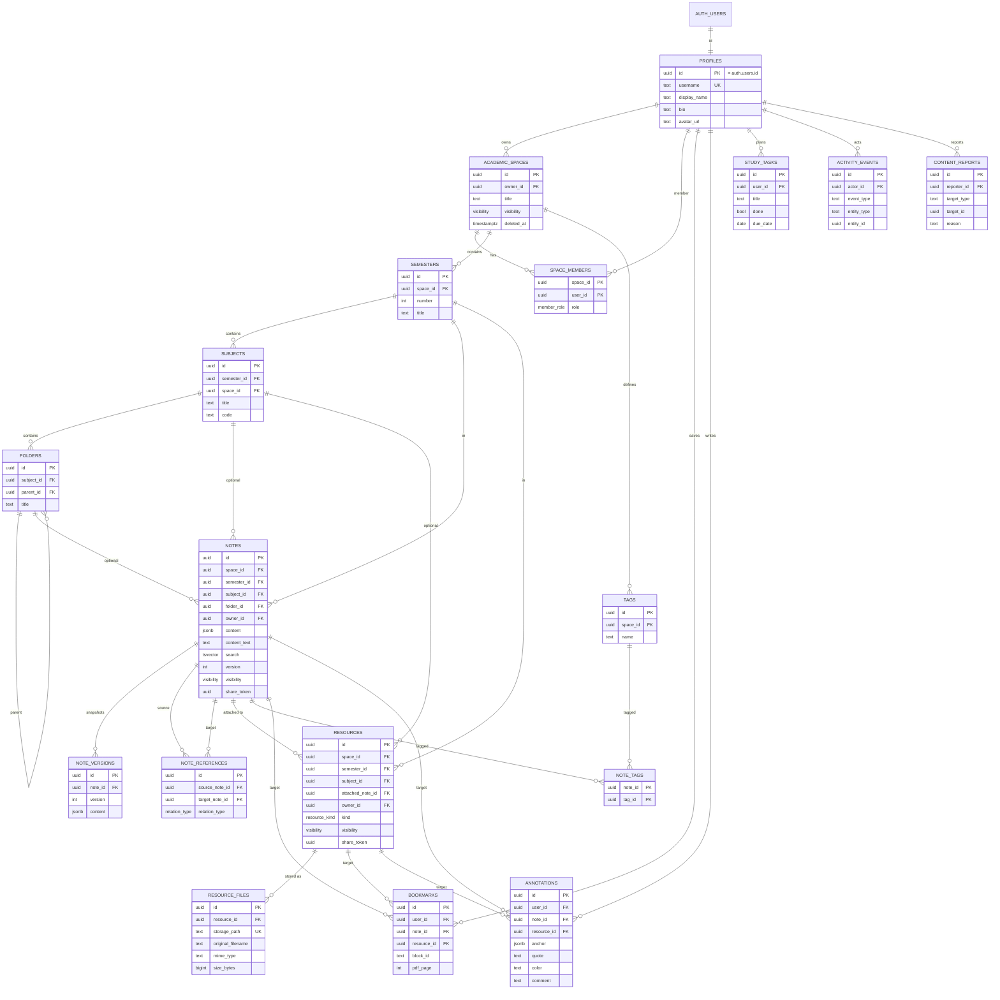

# NoteNest V2 — Technical Design

## 1. Architecture

```
Browser (React, TanStack Query, Tiptap, PDF.js)
   │  supabase-js (anon key + user JWT, PKCE)
   ▼
Supabase ── Auth (GoTrue) ── Postgres (RLS, RPC, triggers, FTS) ── Storage (buckets + policies)
                                   └─ optional Edge Function: shared-file-url (unlisted file access)
Static hosting (any) serves the Vite build. No server of ours holds state or secrets.
```
Trust boundary: **everything authoritative lives in Postgres** (RLS, constraints, triggers, SECURITY DEFINER RPCs). The client is untrusted.

## 2. Access model

| Object state | owner | space editor | space viewer | any signed-in / anon |
|---|---|---|---|---|
| private | RW | RW | R | – |
| unlisted | RW | RW | R | via token RPC only (signed-in) |
| public | RW | RW | R | R (anon included) |
| soft-deleted | R/restore | – | – | – |

* Space-level membership (`space_members`) grants access to **all** content in that space (explicit authorization by the space owner).
* Container rows (space/semester/subject/folder) follow their own visibility; a public note inside a private subject is reachable directly and via search, but its private ancestors are not exposed (breadcrumb parts are fetched with RLS and omitted if unreadable).
* Helper functions (SECURITY DEFINER, `search_path=''`, STABLE): `is_space_owner`, `space_role`, `can_read_space/semester/subject/note/resource`, `can_edit_space`. Policies call these so rules exist once.
* Unlisted: `notes.share_token` / `resources.share_token` (random, rotatable). RLS does **not** grant `select` on unlisted rows to non-members. `get_shared_note(id, token)` / `get_shared_resource` require `auth.uid()`, compare tokens, and write an `activity_events` row.

## 3. ERD (Mermaid)



## 4. Hierarchy integrity (composite FKs)
`semesters UNIQUE(id, space_id)` · `subjects (semester_id, space_id) → semesters(id, space_id)`, `UNIQUE(id, semester_id)` · `folders (subject_id)` + `UNIQUE(id, subject_id)`, parent `(parent_id, subject_id) → folders(id, subject_id)` · `notes/resources (semester_id, space_id)`, `(subject_id, semester_id)`, `(folder_id, subject_id)`.
`owner_id`/`space_id` are immutable (trigger `prevent_identity_change`).

## 5. Triggers and functions
| Name | Purpose |
|---|---|
| `handle_new_user` | on `auth.users` insert → profile (unique username) + private default space "My Space" + "Semester 1" |
| `touch_updated_at` | maintain `updated_at` |
| `note_before_write` | derive `content_text` from JSON (`jsonb_path_query($.**.text)`), bump `version`, enforce size limit |
| `note_snapshot` | write `note_versions` at most once per 5 min per author |
| `soft_delete_cascade` | container delete/restore propagates down the hierarchy |
| `resource_file_guard` | storage object must exist in `files` under `{owner_id}/…`, extension/MIME allow-list, per-user quota |
| `rate_limit` | per-user creation throttle on spaces / notes / resources / reports / annotations |
| `log_activity` | writes `activity_events` on create |
| RPC `search_library` | FTS + filters + pagination, SECURITY INVOKER (RLS applies) |
| RPC `note_reference_graph` | recursive CTE, depth ≤ 3, cycle-safe path array, readability filtered |
| RPC `popular_public_notes`, `recent_public_uploads` | aggregates over public content only |
| RPC `get_shared_note/resource`, `rotate_share_token` | unlisted access |
| RPC `invite_member_by_username` | resolves username → user id without exposing emails |
| RPC `import_study_tasks` | V1 migration helper |

## 6. Storage
* `files` (private, 50 MB limit, MIME allow-list). Path `{owner_uid}/{uuid}.{ext}`. Policies: insert if first folder = `auth.uid()` and extension allowed; select if object is referenced by a `resource_files` row whose resource the caller can read (anon allowed for public); delete by owner.
* `avatars` (public, 2 MB, images). Path `{uid}/…`; write only inside own folder.
* Signed URLs (`createSignedUrl`) are short-lived (5 min for previews/downloads); images in notes are re-signed on render and cached by TanStack Query.

## 7. Frontend structure
```
src/
  lib/            supabase.ts, env.ts, database.types.ts, queryClient.ts, errors.ts
  auth/           AuthProvider, ProtectedRoute, pages (Login, Register, ForgotPassword, ResetPassword)
  api/            typed query/mutation hooks per entity (spaces, hierarchy, notes, resources, files, bookmarks, annotations, references, search, tasks, profile, members)
  editor/         extensions (BlockId, SignedImage, Attachment), NoteEditor, Toolbar, useAutosave, NoteRenderer, annotation decorations
  viewers/        PdfViewer, MarkdownViewer, CodeViewer, ImageViewer, DocxViewer, PptxViewer, FileViewer
  components/     layout/AppShell, ui/*, dialogs/*
  pages/          Landing, Dashboard, Explore, Space, Semester, Subject, Resource, NoteEditorPage, NoteRead, Files, Bookmarks, References, Settings, Planner, NotFound, AccessDenied
```
* TanStack Query: keys per entity; mutations invalidate; 404/403 mapped to NotFound/AccessDenied pages.
* Router: `HashRouter` (host-agnostic). OAuth/PKCE returns to the site root with `?code=`; supabase-js exchanges it before the router renders; `PASSWORD_RECOVERY` event routes to `/reset-password`.

## 8. Editor
Extensions: StarterKit (code block replaced by lowlight), Underline, Link (allow-listed protocols), Highlight (multicolor), TextStyle + Color, Table*, TaskList/TaskItem, Placeholder, custom **BlockId** (assigns uuid `blockId` to block nodes, dedups on paste), custom **SignedImage** and **Attachment** node views. Autosave: 1.2 s debounce → `update notes set content, title … where id and version = :v`; 0 rows → conflict banner (reload / keep mine). Failure → retry button with exponential retry.

## 9. Annotation anchors
`{"type":"block","blockId":"…","start":12,"end":40,"quote":"…","prefix":"…","suffix":"…"}` and `{"type":"pdf","page":3,"rects":[{"x":0.1,"y":0.2,"w":0.3,"h":0.02}],"quote":"…"}`. DB `CHECK (annotation_anchor_valid(anchor))` validates shape.

## 10. Testing strategy
* `tests/db/*.test.mjs` — Node test runner against local Supabase with two real users: RLS read/write isolation, composite-FK integrity, soft delete, references/backlinks/graph/depth, bookmark constraints, unlisted token flow, storage upload/signed-URL/ownership, quota guard, search visibility.
* `scripts/test-logic.ts` — pure logic (anchor re-anchoring, filter/URL state, file validation).
* `e2e/` — Playwright against the production build + local Supabase: sign-up with email confirmation (Mailpit), login, session persistence, logout, password reset, two-user flow, note autosave, upload + PDF preview + bookmark page, cross-semester link, access-denied states, mobile layout.
* CI: typecheck, build, all of the above.

## 11. Deployment
Static `dist/` + hosted Supabase. Env at build time: `VITE_SUPABASE_URL`, `VITE_SUPABASE_ANON_KEY`, `VITE_ENABLE_GOOGLE_AUTH`. Details and Embarko status in `docs/DEPLOYMENT.md`.
