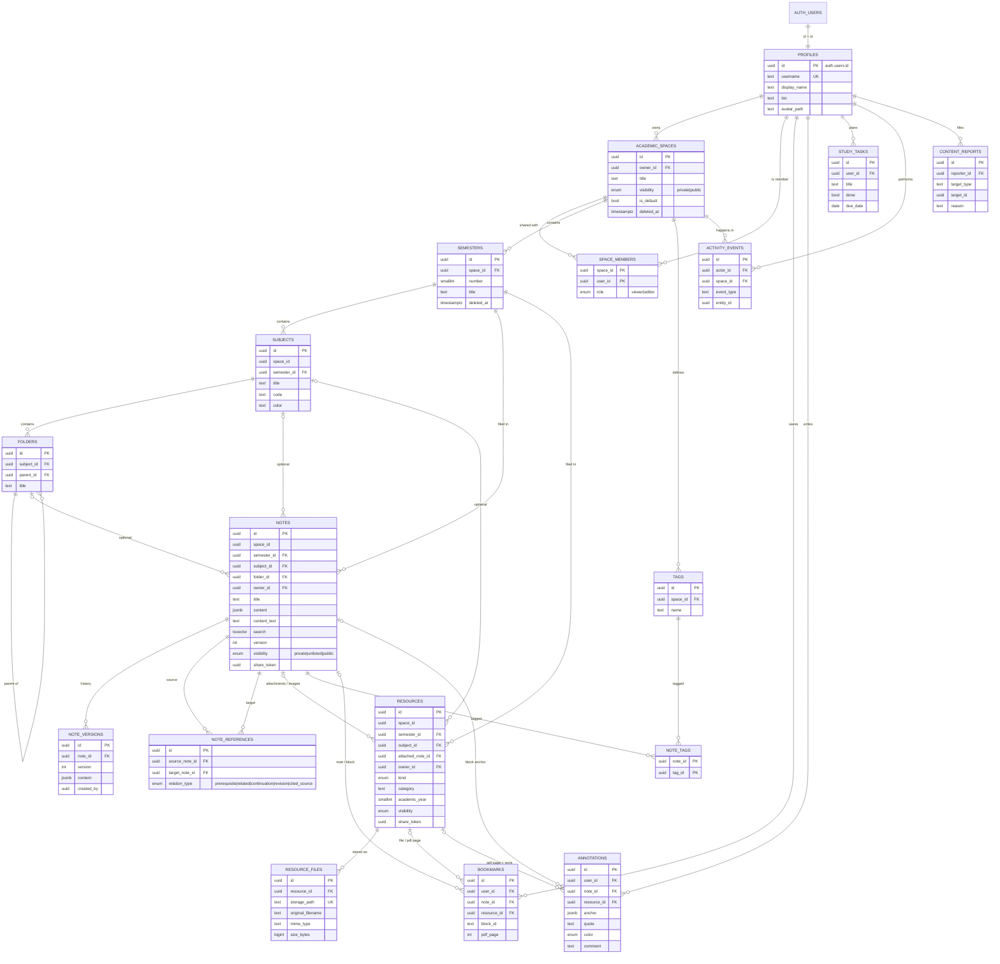

# NoteNest V2 — Entity-relationship diagram

Constraints beyond the arrows:

* composite FKs `(semester_id, space_id)`, `(subject_id, semester_id)`, `(folder_id, subject_id)`, `(attached_note_id, space_id)` keep every hierarchy consistent;
* `note_references`: `UNIQUE (source, target, relation_type)` and `CHECK (source <> target)`;
* `bookmarks`: `CHECK` exactly one target, `block_id ⇒ note`, `pdf_page ⇒ resource`, plus a de-duplicating unique index;
* `annotations`: `CHECK (annotation_anchor_valid(anchor, note_id IS NOT NULL))`.
